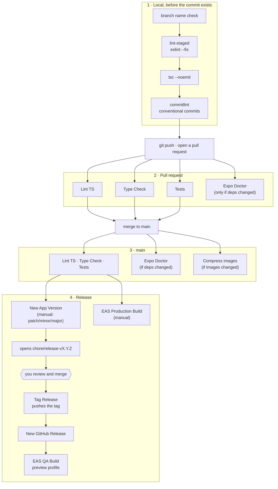

<p align="center">
  
  
  <picture>
    <source media="(prefers-color-scheme: dark)" srcset="./docs/assets/expo-logo-dark.svg" />
    
  </picture>
</p>

<h1 align="center">s(start)-expo</h1>

<p align="center">
  Opinionated Expo template for responsive, multi-platform apps.<br />
  Phone and tablet, iOS and Android — with an agent harness any AI tool can pick up.
</p>

<p align="center">
  
  
  
</p>

---

Built on the **[Obytes React Native / Expo starter](https://github.com/obytes/react-native-template-obytes)** (v9.0.0), then trimmed to a single start screen with no authentication, upgraded to Expo SDK 58, and documented in [`docs/`](./docs/README.md).

The project structure, the CI workflows and most of the tooling choices come from Obytes — credit where it is due. What changed here is scope: everything that was an example was removed, so the first feature you write is the first feature in the app.

## Stack

| Concern | Choice |
| --- | --- |
| Runtime | Expo SDK 58, React Native 0.88, React 19.3 |
| Routing | Expo Router 58 (file-based, typed routes) |
| Styling | Uniwind + Tailwind CSS 4 (`className`, theme via CSS `@theme`) |
| Server state | TanStack Query 5 + axios |
| Client state | Zustand 5 |
| Storage | react-native-mmkv 4 |
| i18n | i18next + react-i18next — `en-US` (default) and `pt-BR` |
| Unit tests | Jest + React Testing Library |
| E2E | Maestro |
| Lint & format | ESLint (`@antfu/eslint-config`, formatting via ESLint Stylistic — no Prettier) |
| Language | TypeScript 6, strict |
| Package manager | pnpm |
| Agent harness | tool-neutral: `AGENTS.md`, `s-expo-*` skills, agents, rules and hooks in `.agents/`, project memory in `docs/memory/` |
| Code quality | crapper (CRAP), dryer (duplication), mutator (mutation testing) — vendored in `tools/` |

## Getting started

```bash
pnpm install
pnpm rename my-app com.acme.myapp   # only when seeding a new project
pnpm env:use development   # copies .env.development.example onto .env.local
pnpm start                 # dev server
pnpm ios                   # run on iOS simulator
pnpm android               # run on Android emulator
```

The second line is not optional on a fresh clone. No `.env` is committed, and `env.ts` validates `EXPO_PUBLIC_API_URL` as a URL — `pnpm prebuild:<environment>` refuses to run without one.

This template uses an Expo custom dev client, so Expo Go is not supported. Build and install the dev client first.

## Editor

`.vscode/` is configured for this project: ESLint fixes on save, Prettier explicitly disabled, Tailwind IntelliSense pointed at `src/global.css` (Tailwind 4 keeps its theme in CSS), and i18n-ally pointed at `src/translations/`.

Install the recommended extensions when prompted, and accept the prompt to use the workspace TypeScript — the project is on TypeScript 6 and the editor's bundled version may be older.

`project.code-snippets` carries prefixes that follow the conventions: `screen`, `route`, `comp`, `test`, `store`, `useq`, `useqv`, `usem`, `useiq`, `nav`.

## Quality gates

```bash
pnpm lint             # eslint
pnpm type-check       # tsc --noemit
pnpm test             # jest
pnpm check-all        # all of the above + translation lint + hook tests
pnpm quality          # CRAP < 10 per function and no duplication >= 0.8
pnpm quality:mutate src/lib/utils.ts   # mutation testing on the files you changed
pnpm harness:score    # agent-harness maturity (L0–L4)
pnpm e2e-test         # maestro flows (requires a running emulator)
```

`pnpm quality` and `quality:mutate` run Python 3.11+ tools; on macOS, `brew install python@3.12` once.

Every change is written test-first. **[`docs/workflow.md`](./docs/workflow.md) is the development loop** — how a change goes from an idea to a merge — and the rest of the conventions live in [`docs/`](./docs/README.md).

## AI agent harness

The repository carries everything an AI coding agent needs to work here, so a conversation can start with one line — *"Follow AGENTS.md. Task: …"* — in any tool, on any model. Switch tools or models when a usage limit runs out and the context comes with the code, not with the chat.

| Piece | Where | What it gives the agent |
| --- | --- | --- |
| Entry point | [`AGENTS.md`](./AGENTS.md) | stack, rules, commands, which skill to use, model tiers, guardrails |
| Memory | [`docs/memory/`](./docs/memory/README.md) | decisions and their reasons, lessons from failures, glossary, work log |
| Skills | `.agents/skills/s-expo-*` | procedures: `s-expo-dev` orchestrates a change; `s-expo-mode` is the coding discipline; release, SDK upgrade, new feature, Maestro, memory, quality gates, harness upkeep |
| Agents | `.agents/agents/s-expo-*` | planner, builder, quality, reviewer, docs keeper — each with its tools and a model tier (`deep` / `standard`), not a vendor model |
| Rules | `.agents/rules/s-expo-*` | non-negotiables loaded only for the files they cover |
| Hooks | `.agents/hooks/` (wired for Claude Code in `.claude/settings.json`) | blocks force-pushing `main`, `--no-verify`, production builds, edits to generated or secret files; runs `eslint --fix` after every edit |
| Entry prompts | `.github/prompts/` | `/s-expo-dev`, `/s-expo-review`, `/s-expo-quality`, `/s-expo-release`, `/s-expo-evolve` in Copilot |

A change runs **plan → test-first build → gates → review → memory → commit**, with at most two build/review loops. The full description, and how to use it from each tool: [`docs/harness.md`](./docs/harness.md).

[harness-score](https://github.com/paladini/harness-score) rates the harness **L4 · Self-correcting, 105/105** (from L0, 51/105 before it existed), and CI keeps it there.

## CI/CD

Four stages. The first runs on your machine, the rest on GitHub Actions.



### 1 · Local, before the commit exists

Husky runs these on `pre-commit` and `commit-msg`. A commit that would fail CI never gets created.

| Step | What it does |
| --- | --- |
| branch name check | rejects a branch that is not `feat/`, `fix/`, `chore/`, `docs/`, `refactor/`, `test/` or `ci/` |
| `lint-staged` | `eslint --fix` on staged files |
| `tsc --noemit` | type-checks the project |
| `commitlint` | enforces Conventional Commits |

`pnpm check-all` runs the same checks plus the tests, on demand.

### 2 · Pull request

| Workflow | Runs | Blocking |
| --- | --- | --- |
| `lint-ts.yml` | `eslint .`, annotated inline by reviewdog | yes — required by the `main` ruleset |
| `type-check.yml` | `tsc --noemit`, annotated inline | yes — required by the `main` ruleset |
| `test.yml` | `jest`, with the summary posted as a comment | yes — required by the `main` ruleset |
| `expo-doctor.yml` | only when `package.json` or `pnpm-lock.yaml` changed | fails the PR, but not required — a path-filtered check cannot be |
| `quality.yml` | `pnpm quality`: CRAP < 10 and no duplication >= 0.8 | yes — required by the `main` ruleset |
| `harness.yml` | hook-rule tests and `harness-score --min-level 4` | yes — required by the `main` ruleset |

**End-to-end tests do not run automatically.** Two Maestro entry points exist and both are manual, because a full Android build plus an emulator run is around an hour of runner time — metered while the repository is private:

| How to run it | What it does |
| --- | --- |
| `pnpm e2e-test` | locally, against a build already installed on a simulator |
| | three flows: `home` renders and every control is reachable, `language` and `theme` each drive one toggle and restore what they found |
| `e2e-android.yml`, from the Actions tab | builds the APK with Gradle in CI, runs Maestro on an emulator |
| `e2e-android-eas-build.yml`, from the Actions tab | runs Maestro against an EAS build URL you paste |

Wire one of them to `pull_request` when the cost is worth paying — the trigger to add is written in a comment at the top of each file.

### 3 · main

The same three gates re-run after the merge, plus two housekeeping jobs: `expo-doctor.yml` when dependencies moved, and `compress-images.yml` when an image was added.

### 4 · Release

One decision starts it, one review carries it through, and the rest is automatic:

1. **New App Version** — run it by hand from the Actions tab and pick `patch`, `minor` or `major`. It bumps the version in `package.json` and opens `chore/release-vX.Y.Z`.
2. **You review and merge it.** `main` is protected by a ruleset that requires a pull request, and a version bump is a change to `main` like any other.
3. **Tag Release** — fires on the merged release pull request and pushes the tag.
4. **New GitHub Release** — fires on the tag and publishes the release.
5. **EAS QA Build** — fires when the release is published and builds the `preview` profile.

**EAS Production Build** stays manual and separate, so nothing ships to a store by accident.

`package.json` is the only file a release touches. `env.ts` reads the version from it and `app.config.ts` reads that, so the app, the build number and the store listing all follow from one line. There is no native code in the repository to keep in step — `ios/` and `android/` are generated.

`GH_TOKEN` is required, and for a reason that is easy to trip over: **nothing done with the automatic `GITHUB_TOKEN` triggers another workflow.** Not a pull request, not a tag, not a release. Each link in the chain would look like it worked — the PR opens, the tag lands, the release publishes — while the next step never fires. Every step that starts the next one is handed the PAT explicitly.

Both EAS workflows need an `EXPO_TOKEN` secret. `EXPO_ACCOUNT_OWNER` and `EAS_PROJECT_ID` are filled in at the top of `app.config.ts` — replace both with your own when this template seeds a new app, using the id `eas init` prints. The pull-request gates need no configuration at all.

Full detail, including every secret and what it is for, in [`docs/ci/workflows.md`](./docs/ci/workflows.md).

## What ships

A single route rendering one screen: a GitHub avatar and handle, a centred title built from the app name plus `Starter`, a one-line description, and two round toggles in the top-right that flip the theme and the language in place. There is no authentication, no tab bar and no example feature — the first feature you add is the first feature in the app.

The avatar comes from `https://github.com/<handle>.png`, which redirects to the current picture for any public account — no API call and no token. `GITHUB_HANDLE` in `src/features/home/components/github-profile.tsx` is the single value to change when this template seeds a new app.

Dark is the theme a fresh install starts on, and `en-US` is the starting language.

`src/components/ui` is trimmed to what the screen actually renders — `Text`, `SafeAreaView`, the focus-aware status bar, the theme mapping and the React Native re-exports (`View`, `Pressable`, `Image`, `ScrollView`, `TouchableOpacity`, `ActivityIndicator`).

`SafeAreaView` is wrapped in `withUniwind` rather than re-exported. Uniwind's Metro resolver only teaches `className` to imports coming from `react-native`; a component re-exported from any other package silently drops the prop on native while web still styles it through the DOM. That one is worth knowing before you re-export a third-party component here. The infrastructure underneath is untouched and fully wired: HTTP client, query provider, MMKV storage, i18n, theming, testing and CI.

Everything removed along the way — data fetching, Zustand stores, forms, settings rows, the button, input, checkbox, select and modal components — is preserved verbatim in [`docs/reference/removed-patterns.md`](./docs/reference/removed-patterns.md). Copy a pattern back when you need it instead of rewriting it.

## Project structure

```
src/
├─ app/            # Expo Router routes — thin re-exports only
├─ features/       # one folder per domain: screen, components/, api.ts, store
├─ components/ui/  # design system
├─ lib/            # infrastructure: api client, i18n, storage, hooks
└─ translations/   # en-us.json, pt-br.json
.agents/           # agent harness, tool-neutral: skills/, agents/, rules/, hooks/
.claude/           # Claude Code adapter: links into .agents/ + settings.json
docs/memory/       # project memory for every session and model
tools/             # vendored quality tools: crapper, dryer, mutator
```

Dependency rule — imports only flow to the right:

```
app/  →  features/  →  components/ui/  →  lib/
```

A feature never imports another feature. Shared code moves up into `lib/` or `components/ui/`.

## Environments

`env.ts` recognises three environments — `development`, `preview` and `production` — and each one selects its own bundle id, package name and URL scheme.

Expo only loads the standard dotenv files (`.env`, `.env.local`, `.env.[NODE_ENV]`, `.env.[NODE_ENV].local`), and the Expo docs recommend against switching environments through `NODE_ENV`. So the per-environment files here are **examples**, not files Expo reads. Pick one before your first run:

```bash
pnpm env:use development   # or preview / production
pnpm start --clear
```

That copies the matching example onto `.env.local`, which Expo loads with precedence.

| File | Tracked | Purpose |
| --- | --- | --- |
| `.env.development.example` | yes | template for local development |
| `.env.preview.example` | yes | template for preview / QA |
| `.env.production.example` | yes | template for production values |
| `.env.local` | no | the environment you are actually running |

**No `.env` is committed, and `.gitignore` refuses every `.env*` that is not an `.example`.** A tracked env file is one careless edit away from putting a real credential in git history, and history is public the moment the repository is.

EAS builds do not use these files: `eas.json` sets `EXPO_PUBLIC_APP_ENV` per build profile and reads the rest from the matching EAS environment.

Never put a real secret in an `EXPO_PUBLIC_` variable — those are inlined in plain text into the app bundle.

## Starting a new project from this template

**[`docs/guides/start-a-new-project.md`](./docs/guides/start-a-new-project.md) is the ordered checklist** — naming and bundle ids, linking EAS, the two places `EXPO_PUBLIC_API_URL` has to exist, the exact token permissions the release chain needs, and what to expect the first time each thing runs.

It was written by doing it once and hitting every wall. Follow it and the walls are already gone; the template is then complete except for the idea.

## Git workflow

`main` is the only long-lived branch. Every change starts from it on a new branch named `feat/…`, `fix/…`, `chore/…`, `docs/…`, `refactor/…`, `test/…` or `ci/…`, and lands through a pull request. Commits follow Conventional Commits, enforced by commitlint.

## Acknowledgements

This template stands on other people's work. Thank you to:

- **[Obytes](https://github.com/obytes/react-native-template-obytes)** — the React Native / Expo starter this project began as. Structure, CI and most tooling choices are theirs.
- **[revfactory/harness](https://github.com/revfactory/harness)** — the harness method: team patterns, execution modes, skill design and the evolve loop behind `s-expo-harness`, `s-expo-evolve` and the `s-expo-dev` orchestrator.
- **[Robert C. Martin (unclebob)](https://github.com/unclebob)** — [ub-mode](https://github.com/unclebob/ub-mode), the discipline behind `s-expo-mode` (itself building on [@poteto](https://github.com/poteto)'s rules), and the tools that hold code to it: [crapper](https://github.com/unclebob/crapper), [dryer](https://github.com/unclebob/dryer) and [mutator](https://github.com/unclebob/mutator).
- **[Fernando Paladini](https://github.com/paladini/harness-score)** — harness-score, which measured where the harness stood and what was missing.

Everything taken was adapted and renamed for this project; licenses, upstream commits and what changed are in [THIRD_PARTY_NOTICES.md](./THIRD_PARTY_NOTICES.md).

## License

[MIT](./LICENSE).
