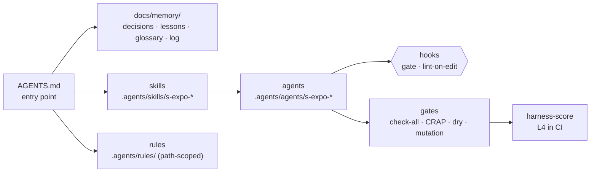

# The agent harness

An AI coding agent is a model plus a **harness**: the context, procedures, guardrails and sensors around it. The model is rented and changes — you switch tools when one hits a usage limit. The harness lives in this repository, so every clone, tool and model gets the same one.

The goal is short conversations. Anything you would otherwise re-explain in chat is written down here once.

## Layers

Everything lives in tool-neutral places — `AGENTS.md`, `.agents/`, `docs/` — as plain Markdown. Tool folders are thin adapters that point into them.

| Layer | Where | What it does |
| --- | --- | --- |
| Entry point | `AGENTS.md` | stack, structure, rules, commands, skill/agent tables, model tiers, guardrails, adapters, harness change history |
| Memory | `docs/memory/` | decisions with reasons, non-obvious failures, domain terms, a work log (`s-expo-memory`) |
| Skills | `.agents/skills/s-expo-*/SKILL.md` | procedures: how to do a kind of work |
| Agents | `.agents/agents/s-expo-*.md` | roles: who does a phase, with which tools and which **tier** of model |
| Rules | `.agents/rules/s-expo-*.md` | non-negotiables for the files matching their `paths:` |
| Hooks | `.agents/hooks/` | a gate that blocks irreversible or guardrail-skipping actions; `eslint --fix` after each edit |
| Gates | `pnpm check-all`, `pnpm quality`, `pnpm quality:mutate` | deterministic answers to "is it right?" |
| Measurement | `pnpm harness:score`, `harness.yml` | the harness's own maturity, gated at L4 |

## How a change flows

The `s-expo-dev` skill runs a change as a pipeline with a producer–reviewer loop, one role per phase:

| Phase | Agent | Tier | Writes |
| --- | --- | --- | --- |
| 0 context | main thread | — | reads memory, classifies the change, branches |
| 1 plan | `s-expo-planner` (read-only) | deep | `_workspace/01_planner_plan.md` |
| 2 build | `s-expo-builder` | deep | code + `_workspace/02_builder_log.md` |
| 3 gates | `s-expo-quality` (read-only) | standard | `_workspace/03_quality_report.md` |
| 4 review | `s-expo-reviewer` (read-only) | deep | `_workspace/04_reviewer_findings.md` |
| 5 record | `s-expo-docs-keeper` | standard | `docs/memory/*` |
| 6 commit | main thread | — | Conventional Commits, PR on request |

Build ↔ review loops at most twice. `_workspace/` is git-ignored and kept after a run, so "continue" or "fix the findings" resumes instead of restarting. In a tool with subagents each phase is a separate agent; in any other tool the same model plays each role in turn, reading the agent file for that phase.

## Models: tiers, not names

Agents never name a vendor's model. They name a **tier** — `deep` for design, code and review; `standard` for running commands and structured writing — and each tool maps the tier to whatever it has. The table is in `AGENTS.md` under *Model tiers*.

Two reasons. A different tool has different models, and the harness must not care. And models are retired and renamed: when that happens, nothing in `.agents/` changes. The only vendor names live in an adapter — for Claude Code, the `model:` field of each agent (`deep` → `inherit`, the session's own model; `standard` → `sonnet`, an alias that always points at the current model of that family). If that alias ever stops resolving, it is a one-word change to `inherit`. When in doubt, the session model is always a valid choice: the gates, not the model, decide whether the work is right.

## Adapters per tool

| Tool | What loads natively | What you do by hand |
| --- | --- | --- |
| Claude Code | `CLAUDE.md` → `AGENTS.md`; skills, subagents and path rules through `.claude/*` links into `.agents/`; hooks, permissions and the official Expo plugin (Expo skills + MCP) from `.claude/settings.json` | nothing |
| Codex, OpenCode and other `AGENTS.md` readers | `AGENTS.md`; skills from `.agents/skills/` | play the agent roles yourself; follow the guardrails (hooks are not wired) |
| GitHub Copilot | `AGENTS.md`; `.github/prompts/` gives `/s-expo-dev`, `/s-expo-review`, `/s-expo-quality`, `/s-expo-release`, `/s-expo-evolve` | follow the guardrails |
| Cursor, Windsurf, Cline, Zed and others | `AGENTS.md` | open the skill the task needs; follow the guardrails |

Where hooks are not wired, the guardrails in `AGENTS.md` still apply — nothing enforces them mechanically, and the five required CI checks catch what slips through. Adding a new tool means adding an adapter row, never moving content out of `.agents/`.

The Claude Code adapter links each skill, agent and rule individually rather than linking whole folders: some tools — harness-score among them — do not follow a linked directory. `s-expo-adapters.test.mjs` (run by `pnpm test:hooks` and in CI) fails when an item has no link or a link points nowhere. On Windows, clone with `git config core.symlinks true` so the links are links, not text files.

A good opening message in any tool is one line: *"Follow AGENTS.md. Task: …"*.

## The quality layer

Lint, types and tests say the code is not broken. The quality layer, from [unclebob/ub-mode](https://github.com/unclebob/ub-mode), says it is easy to change:

| Tool | Measures | Threshold | Command |
| --- | --- | --- | --- |
| crapper | CRAP = CC² × (1 − coverage)³ + CC, per function | < 10 | `pnpm quality:crap` |
| dryer | structural similarity between functions | < 0.8 | `pnpm quality:dry` |
| mutator | whether tests notice a changed operator | no survivors | `pnpm quality:mutate <file>` |

They are Python 3.11+ tools vendored verbatim in `tools/` (see [THIRD_PARTY_NOTICES.md](../THIRD_PARTY_NOTICES.md)); `scripts/quality.sh` finds a suitable Python, builds a virtualenv per tool on first use, and turns each threshold into an exit code. Reports land in `.metrics/` (git-ignored).

When the layer was introduced it found five functions over CRAP 10, one duplicated pair and three surviving mutants in `src/lib/` — two of them dead code. All were fixed test-first in the same change.

## Measuring the harness

[harness-score](https://github.com/paladini/harness-score) scans the repository — files only, no LLM, no network — and rates it L0–L4 across context, skills, hooks, sensors, CI and hygiene. `pnpm harness:score` runs it locally; `harness.yml` fails a pull request that drops the repository below L4.

| | Before | After |
| --- | --- | --- |
| Level | L0 · Unharnessed | L4 · Self-correcting |
| Score | 51 / 105 | 105 / 105 |

`.harness-score.json` switches off one check, `SNS-04` (formatter configured): the scanner recognises Prettier and Biome, not ESLint Stylistic, which is this project's formatter. Adding Prettier only to satisfy it would contradict the project's own rule. Remove the override if the scanner learns to detect ESLint Stylistic.

## Changing the harness

- **Add or change** an agent, skill, rule or hook → `s-expo-harness` skill. It audits first, checks for overlap, and verifies with hook tests, lint and harness-score.
- **Feed back** a correction you had to make by hand → `s-expo-evolve`. It generalises the correction into a principle and records it in the change history in `AGENTS.md`.
- Every name is `s-expo-*`. `pnpm rename` leaves those names alone when this template seeds another app (it only matches `s-expo` as a whole word), so the harness keeps working; rename them deliberately with `s-expo-harness` if you want your own prefix. Keep the details in the skills; `AGENTS.md` carries only the tables, the trigger and the change history.

## Credits

The method comes from [revfactory/harness](https://github.com/revfactory/harness) (Apache-2.0), the engineering discipline from [unclebob/ub-mode](https://github.com/unclebob/ub-mode) (MIT), the quality tools from [unclebob/crapper](https://github.com/unclebob/crapper), [dryer](https://github.com/unclebob/dryer) and [mutator](https://github.com/unclebob/mutator) (0BSD), and the measurement from [paladini/harness-score](https://github.com/paladini/harness-score) (MIT). Everything here is adapted and renamed for this project; the originals are linked in [THIRD_PARTY_NOTICES.md](../THIRD_PARTY_NOTICES.md).
